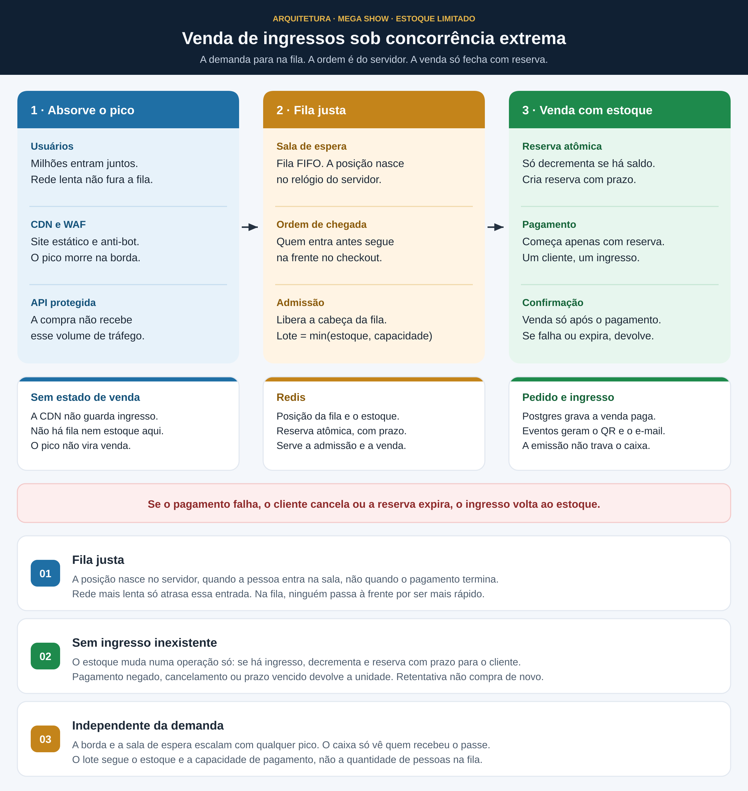

# Venda de ingressos sob concorrência extrema

Arquitetura para a abertura de vendas de um mega show: estoque muito menor que a demanda, sem vender ingresso que não existe, e sem deixar a internet mais rápida furar a fila.

## Como ler

O tráfego entra pela esquerda. A venda só fecha na direita.

1. **Absorve o pico.** CDN, página estática e anti-bot seguram milhões de acessos. A API de compra não vê esse volume, e a borda não guarda estoque.
2. **Fila justa.** A posição é um contador do servidor, na ordem em que a pessoa entra na sala. A admissão libera um lote por vez: `min(estoque, capacidade)`.
3. **Venda com estoque.** A reserva é atômica e tem prazo. O pagamento só começa com essa reserva. Se falha, cancela ou expira, o ingresso volta. O QR code e o e-mail saem depois, por fila de eventos.

## Garantias

- **Fila justa.** A posição nasce quando a entrada chega ao servidor, não quando o checkout termina. Internet mais lenta atrasa a entrada na fila; não perde a vez para quem dispara a compra mais rápido.
- **Sem ingresso inexistente.** O estoque só diminui se ainda há ingresso, na mesma operação que cria a reserva. Sem reserva válida, não há pagamento nem venda.
- **Independente da demanda.** A fila absorve qualquer pico. O caixa só processa quem recebeu passe de admissão, no ritmo do estoque e da capacidade de pagamento.
venda-ingresso-arq
