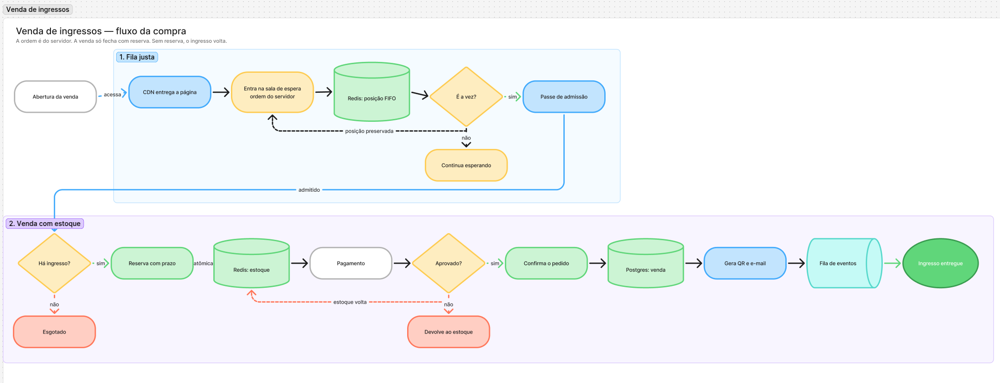

# Venda de ingressos sob concorrência extrema

Arquitetura para a abertura de vendas de um mega show: estoque muito menor que a demanda, sem vender ingresso que não existe, e sem deixar a internet mais rápida furar a fila.

A demanda para na fila. A ordem é do servidor. A venda só fecha com reserva.

## Arquitetura

O tráfego entra pela esquerda. A venda só fecha na direita.

1. **Absorve o pico.** CDN, página estática e anti-bot seguram milhões de acessos. A API de compra não vê esse volume, e a borda não guarda estoque.
2. **Fila justa.** A posição é um contador do servidor, na ordem em que a pessoa entra na sala. A admissão libera um lote por vez: `min(estoque, capacidade)`.
3. **Venda com estoque.** A reserva é atômica e tem prazo. O pagamento só começa com essa reserva. Se falha, cancela ou expira, o ingresso volta. O QR code e o e-mail saem depois, por fila de eventos.

Cada etapa tem o seu dado, e nenhum deles vive na borda:

| Etapa | Onde fica o dado | O que guarda |
| --- | --- | --- |
| Absorve o pico | CDN | Nada de venda. Sem fila e sem estoque. |
| Fila justa e reserva | Redis | Posição FIFO, estoque e reserva com prazo. |
| Confirmação | Postgres | A venda paga. Eventos geram o QR e o e-mail sem travar o caixa. |

## Fluxo da compra

O mesmo caminho, agora na ordem em que a pessoa passa por ele. Quem não é a vez espera com a posição guardada. Quem não paga devolve o ingresso.

### 1. Fila justa

1. A venda abre e a CDN entrega a página. O pico fica na borda.
2. A pessoa entra na sala de espera. A posição nasce no Redis, na ordem em que a entrada chega ao servidor.
3. Se ainda não é a vez, ela continua esperando. A posição permanece.
4. Quando chega a vez, recebe o passe de admissão e segue para o caixa.

### 2. Venda com estoque

1. O caixa pergunta se ainda há ingresso. Se não há, a venda encerra como esgotada. Nada é cobrado.
2. Se há, a reserva é atômica: o Redis só decrementa o estoque se ainda existe saldo, e cria a reserva com prazo na mesma operação.
3. O pagamento só começa com essa reserva. Um cliente, um ingresso.
4. Pagamento aprovado grava a venda no Postgres. A fila de eventos gera o QR code e o e-mail, e o ingresso é entregue.
5. Pagamento recusado, cancelamento ou prazo vencido devolve a unidade ao estoque. A retentativa não compra de novo.

## Garantias

- **Fila justa.** A posição nasce quando a entrada chega ao servidor, não quando o checkout termina. Internet mais lenta atrasa a entrada na fila; não perde a vez para quem dispara a compra mais rápido.
- **Sem ingresso inexistente.** O estoque só diminui se ainda há ingresso, na mesma operação que cria a reserva. Sem reserva válida, não há pagamento nem venda.
- **Independente da demanda.** A fila absorve qualquer pico. O caixa só processa quem recebeu passe de admissão, no ritmo do estoque e da capacidade de pagamento.
